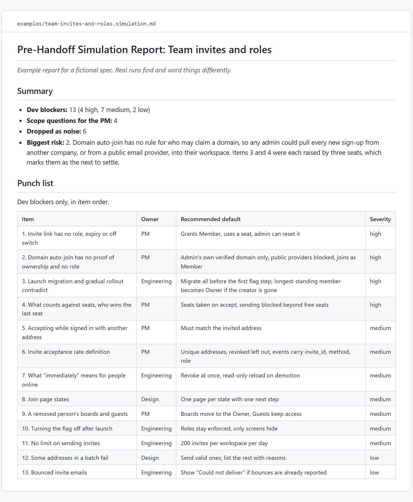
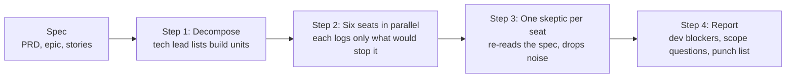

# PRD Simulator

**Simulate building your PRD before engineers do.** A panel of developer personas finds what would block them, a skeptic removes the noise, and you get a punch list.

[Install](#install) · [Example prompts](#example-prompts) · [How it works](#how-it-works) · [Example report](examples/team-invites-and-roles.simulation.md) · [The method](docs/method.md) · [Privacy](PRIVACY.md)

[](https://github.com/ardaasaroglu/prd-simulator/actions/workflows/ci.yml)



*Part of the [example report](examples/team-invites-and-roles.simulation.md) for a fictional PRD.*

> **Status: v0.2.1.** One skill and seven subagents, made of prompts. It works in Claude Code, in Cowork and in claude.ai chat. It passes `claude plugin validate --strict` and its structure is covered by tests. Reports vary from run to run.

## Why it exists

Specs get reviewed for intent. Is this the right feature, does it solve the problem, does everyone agree. Then a developer opens the spec on day one and gets stuck on something nobody read for: which role does the invite link grant, what happens when two people take the last seat, what the screen shows when the call fails offline.

Those questions are cheap before handoff and expensive after it. PRD Simulator asks them early by simulating the build. Six developer personas read the spec as the people who have to build it tomorrow, and each one writes down only what would make it stop, or guess. A separate skeptic re-reads the spec and throws out everything that is already answered, speculative or a nit. What is left is a short list of decisions, each tied to the sentence it comes from, with an owner and a recommended default.

## Install

**claude.ai and Cowork.** Once PRD Simulator is listed in Claude's plugin directory, add it from **Customize > Plugins**. Until then, download this repository as a zip and add it with **Customize > Plugins > Add > Upload plugin**.

**Claude Code.** In your terminal:

```bash
claude plugin marketplace add ardaasaroglu/prd-simulator
claude plugin install prd-simulator@prd-simulator
```

Or inside a session:

```text
/plugin marketplace add ardaasaroglu/prd-simulator
/plugin install prd-simulator@prd-simulator
```

`prd-simulator@prd-simulator` reads as plugin@marketplace: this repository is both. To try it without installing, clone the repository and run `claude --plugin-dir ./prd-simulator`, then `/prd-simulator:simulate prd-simulator/examples/team-invites-and-roles.md`. Update with `claude plugin update prd-simulator@prd-simulator`, then restart Claude Code.

### What runs where

| | Claude Code | Cowork | claude.ai chat |
|---|---|---|---|
| The seats | Six subagents in parallel | Six subagents in parallel | One after another in the same conversation |
| The skeptic | Separate subagents, one per seat | Separate subagents, one per seat | A separate final pass that re-reads the spec |
| The report | A Markdown file in your folder | A Markdown file in your folder | In the conversation, or a file if file creation is on |

## Example prompts

Each of these works as written. Attach or paste your spec, or point to a file.

* "Here is our PRD for team invites. Simulate the build and tell me what engineers would get stuck on before handoff."
* "I'm handing this epic and its stories to engineering on Monday. Run a pre-handoff simulation and give me the punch list."
* "Pressure-test this spec with only the backend and security seats."
* "Check this PRD against our architecture notes in docs/architecture.md and list only the real blockers."
* In Claude Code: `/prd-simulator:simulate docs/prd.md --seats backend,qa --out reviews/prd-simulation.md`

## Usage

Point it at a spec file. Several files, such as a PRD and its stories, are read as one spec. A directory stands for the `.md` and `.txt` files in it.

```text
/prd-simulator:simulate docs/prd-team-invites.md
/prd-simulator:simulate docs/epic.md docs/stories/ --context docs/architecture-notes.md
/prd-simulator:simulate docs/prd.md --seats backend,security --out reviews/prd-simulation.md
```

You can also paste the spec after the command, or ask in plain words with the spec in the conversation, for example "I'm handing this epic to engineering on Monday. What will they get stuck on?". The skill's description is written so Claude picks it up from a request like that.

| Option | What it does |
|---|---|
| `--seats backend,qa` | Runs only these seats. Names: `backend`, `frontend`, `integrations`, `data`, `security`, `qa`. Plain words such as "only backend and security" work too. |
| `--out <path>` | Where to save the report. Default: `prd-simulation-<spec>-<date>.md` in the current directory. |
| `--context <path>` | Files that record decisions already made or describe the existing system. Anything they answer is not raised. |

The report is saved as markdown. In chat you get a short brief: dev blockers by severity, the biggest risk, each dev blocker with the spec sentence it comes from, the punch list, the scope questions listed separately, and the items to verify with engineering.

## How it works



The skill's instructions describe these four steps:

1. **Decompose.** The main session, acting as tech lead, splits the spec into build units: endpoints, data model changes, screens and states, integration calls, background jobs, state transitions and migrations. Each unit is tagged with the seats it touches.
2. **Seats.** The skill launches each seat as its own plugin subagent, all in one message so they run in parallel, with read-only tools. A seat logs a finding only when it would have to stop and ask, silently guess, handle a state the spec never mentions, or call an integration with a missing contract detail. Every finding quotes the spec sentence or names the missing section. An empty list is a valid answer.
3. **Skeptic.** For each seat with findings, the skill launches an independent skeptic that reads the spec from scratch, without the build units or the other seats' work, and sorts every finding into `dev_blocker`, `scope_question` or `noise`. When unsure, it chooses noise.
4. **Report.** Findings raised by several seats are merged, because overlap signals importance. Suspected conflicts with the existing system are marked "Verify with engineering, not confirmed" and never stated as fact.

If subagents are not available, the skill tells Claude to run the seats one after another in one context, then run the skeptic as a separate final pass, and to say so in the report.

### The seats

| Seat | Owns |
|---|---|
| Backend | APIs and contracts, data model, state machines, idempotency, concurrency, partial failure and retry, migrations |
| Frontend and mobile | Every screen state (empty, loading, error, offline, pending, partial), validation, accessibility, error copy, perceived latency |
| Integrations | Third-party APIs and webhooks: auth, field mapping, rate limits, timeouts, retries, sandbox vs production, vendor failure modes |
| Data and analytics | Event and metric definitions, reporting, backfills, existing-data migration, retention, personal data in logs |
| Security and privacy | Authentication and authorization, roles and permissions, abuse and fraud vectors, personal data handling, audit trail, compliance hooks |
| QA and release | Edge cases, race conditions, double submit, test data, feature flags and rollout, rollback, observability and alerts, regression surface |

Each seat's full card, with the questions it asks and what it ignores, is in [seat-cards.md](skills/simulate/references/seat-cards.md).

### The report

1. Summary: dev blockers by severity, scope questions, noise dropped, and the biggest risk
2. Blockers (resolve before handoff)
3. Silent assumptions to confirm
4. Missing requirements (states and edge cases)
5. Integration gaps
6. Scope questions for the PM (not dev blockers)
7. Dropped as noise, one line each with the reason
8. Punch list: dev blockers only, with owner, recommended default and severity

Two fictional examples show the format: a B2B [team invites and roles PRD](examples/team-invites-and-roles.md) with its [report](examples/team-invites-and-roles.simulation.md), and a mobile [offline order history and refunds epic](examples/offline-order-history-and-refunds.md) with its [report](examples/offline-order-history-and-refunds.simulation.md). Both are examples for fictional specs.

## What it is not

* **Not a code review.** A code review reads code after it is written. This reads the spec before any code exists.
* **Not a red team of the strategy.** It does not ask whether the feature is worth building. It asks what is missing to build it as written.
* **Not a pre-mortem.** A pre-mortem imagines the project has failed and asks why. This imagines the build starts tomorrow and asks where it stops.

It does not replace engineering review either. It prepares it, so the review spends its time on decisions instead of discovering them.

## Cost and runtime

Not measured for this release. A full run starts up to 13 model contexts: the main session, six seats and up to six skeptics, and every seat and skeptic reads the whole spec. Expect it to cost several times a single review prompt and to take minutes, not seconds. `--seats` runs fewer seats and costs less.

Installed, the plugin adds about 740 tokens to every session for the skill and agent descriptions, as estimated by `claude plugin details prd-simulator`. The full prompts load only when the skill runs.

## Using the method without the plugin

The method works with any capable assistant, or with people around a table. [docs/method.md](docs/method.md) describes it on its own, with a prompt to start from. Without subagents, run the seats one after another and the skeptic as a separate final pass, ideally in a fresh conversation, so it judges the findings without the seats' reasoning.

## What it reads, writes and sends

* **Reads:** only the spec you give it (paths, pasted text or an attached document) and any `--context` files.
* **Sends:** nothing outside your conversation with Claude. The plugin makes no network calls and has no server, account or analytics.
* **Writes:** one Markdown report. In Claude Code and Cowork it goes in your working folder; in claude.ai chat it appears in the conversation. It never edits the spec.

[PRIVACY.md](PRIVACY.md) has the details.

## Troubleshooting

* **Claude does not use the skill.** Ask for it by name ("run the PRD Simulator on this spec") or, in Claude Code, type `/prd-simulator:simulate` with the spec path. Check that the plugin is turned on in **Customize > Plugins** or with `/plugin`.
* **"Spec not found".** Use a path relative to the folder Claude Code runs in, or attach the file. A directory stands for the `.md` and `.txt` files in it.
* **The seats ran one after another.** That is the expected behavior in claude.ai chat, which has no subagents. In Claude Code, it means subagents are turned off; the report header says which run mode was used.
* **The report is long or noisy.** Run fewer seats with `--seats`, or pass `--context` with the decisions that are already made.
* **Something else.** Open an issue at https://github.com/ardaasaroglu/prd-simulator/issues with the run mode from the report header and, if you can share it, the spec.

## Evals

[`evals/`](evals) holds three cases for `claude plugin eval`: a gappy spec must yield blockers tied to quoted spec lines and a punch list, a small complete spec must not get manufactured blockers, and a plain request must trigger the skill. The cases ship without published scores for now. [docs/evals.md](docs/evals.md) explains the cases, how to run them and what they cost.

## Limitations

* **It reads the spec, not your system.** It cannot see your codebase or your existing services, so a suspected conflict is only ever a question for engineering. Pass `--context` with architecture notes or an API reference to cut false alarms.
* **Results vary between runs.** Two runs on the same spec will not produce identical lists. Treat the report as a checklist for the handoff conversation, not a verdict.
* **The skeptic is a model too.** It removes much of what is already answered or speculative, but it is not a substitute for a person who knows the product.
* **Long specs cost more.** Every seat reads the whole spec. A spec set larger than the model's context window will not fit.
* **The parallel panel needs subagents.** Claude Code and Cowork run the seats in parallel; claude.ai chat runs them one after another in one context, which is less independent. The skill launches its seats as plugin subagents named `prd-simulator:<seat>`. If Claude Code rejects those agent types, the skill loads the same prompts into general-purpose subagents and tells them to use only Read, Grep and Glob. That limit is then an instruction, not a tool restriction.

## Contributing

Issues and small pull requests are welcome. Read [CONTRIBUTING.md](CONTRIBUTING.md) first: it explains why seat cards live in two places and how `npm test` keeps them in step. Run `npm test` and `claude plugin validate . --strict` (Claude Code 2.1.281 or later) before you open a pull request.

For a security problem, follow [SECURITY.md](SECURITY.md) instead of opening an issue.

## License

[MIT](LICENSE), copyright 2026 Arda Asaroglu.
